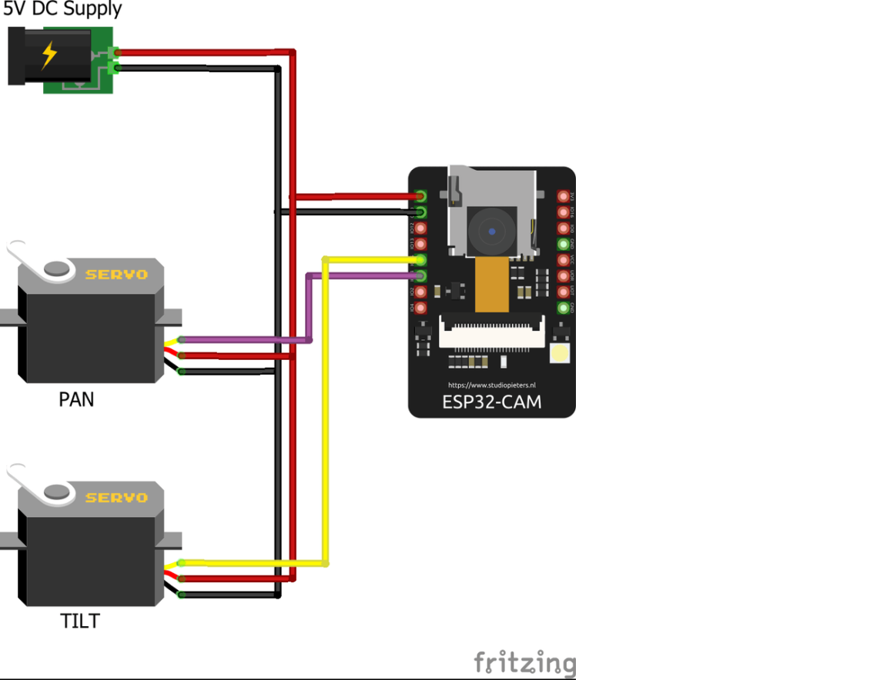
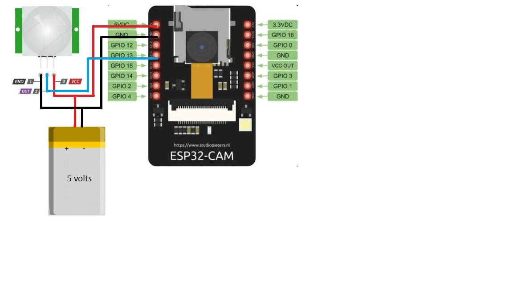

# Sistem inteligent de supraveghere video IoT cu ESP32-CAM
## IoT Smart Surveillance System using ESP32-CAM

---

# 🇷🇴 Română

## 1. Prezentarea proiectului

Acest proiect implementează un sistem de supraveghere video și monitorizare IoT folosind placa ESP32-CAM AI Thinker.

Sistemul permite monitorizarea video printr-o interfață web, detectarea mișcării cu ajutorul unui senzor PIR și transmiterea fotografiilor către utilizator prin intermediul unui bot Telegram.

Camera poate fi orientată de la distanță folosind două servomotoare, PAN și TILT. Iluminarea suplimentară este realizată cu LED-ul flash integrat al plăcii, a cărui luminozitate poate fi reglată din interfața web sau prin Telegram.

## 2. Funcționalități

- Transmisie video live prin Wi-Fi.
- Interfață web pentru monitorizarea camerei.
- Control PAN și TILT folosind două servomotoare.
- Reglarea luminozității LED-ului flash.
- Detectarea mișcării folosind senzorul PIR.
- Capturarea și transmiterea fotografiilor prin Telegram.
- Notificări Telegram la detectarea mișcării.
- Comenzi Telegram pentru controlul sistemului.
- Autentificare HTTP Basic pentru interfața web.

## 3. Componente hardware

| Componentă | Cantitate | Rol |
|---|---:|---|
| ESP32-CAM AI Thinker | 1 | Procesare, cameră și conectivitate Wi-Fi |
| Servomotor | 2 | Orientare PAN și TILT |
| Senzor PIR | 1 | Detectarea mișcării |
| Sursă externă pentru servouri | 1 | Alimentarea servomotoarelor |
| Fire de conectare | - | Realizarea conexiunilor |

## 4. Configurarea pinilor GPIO

| Componentă | Pin ESP32-CAM | Funcție |
|---|---:|---|
| Servo PAN | GPIO14 | Orientare orizontală |
| Servo TILT | GPIO15 | Orientare verticală |
| Senzor PIR | GPIO13 | Detectarea mișcării |
| LED Flash | GPIO4 | Iluminare cu luminozitate reglabilă |

### Observații privind pinii

- GPIO13 și GPIO14 sunt utilizați și de interfața microSD. Proiectul nu utilizează simultan cardul microSD.
- GPIO15 este un pin de configurare la pornire (strapping pin). Conexiunea servomotorului poate influența pornirea plăcii în anumite condiții.
- GPIO4 controlează LED-ul flash integrat.
- Configurația camerei utilizează LEDC pentru semnalul XCLK. PWM-ul servomotoarelor și al flash-ului trebuie verificat pentru eventuale conflicte de resurse LEDC.

## 5. Scheme de conectare

### 5.1 Servomotoare PAN și TILT

Conectarea semnalelor:

| Servomotor | Semnal | ESP32-CAM |
|---|---|---|
| PAN | Signal | GPIO14 |
| TILT | Signal | GPIO15 |

Alimentarea servomotoarelor trebuie realizată folosind o sursă externă stabilizată, dimensionată pentru curentul necesar.

Conectează GND-ul sursei externe la GND-ul ESP32-CAM.

Imaginea schemei de conectare:



### 5.2 Senzor PIR

| Pin senzor PIR | ESP32-CAM |
|---|---|
| OUT | GPIO13 |
| GND | GND |
| VCC | Conform specificațiilor modulului PIR |



Verifică tensiunea semnalului OUT înainte de conectarea la ESP32-CAM. Intrările GPIO ale ESP32 nu sunt tolerante la 5 V.

## 6. Arhitectura software

Programul este organizat în funcții pentru fiecare subsistem:

| Funcție | Responsabilitate |
|---|---|
| `initializeazaCamera()` | Inițializarea camerei |
| `conectareWiFi()` | Conectarea la rețeaua Wi-Fi |
| `initializeazaServouri()` | Inițializarea servomotoarelor |
| `seteazaFlash()` | Reglarea luminozității LED-ului |
| `pornesteServerWeb()` | Pornirea serverelor HTTP |
| `fluxHandler()` | Transmisia video MJPEG |
| `actionHandler()` | Controlul servomotoarelor |
| `flashHandler()` | Reglarea iluminării din browser |
| `trimiteFotografieTelegram()` | Capturarea și transmiterea fotografiei |
| `verificaTelegram()` | Preluarea comenzilor Telegram |
| `verificaSenzorPIR()` | Detectarea mișcării |

## 7. Configurarea Telegram

Botul Telegram permite controlul și monitorizarea sistemului.

Comenzi disponibile:

| Comandă | Funcție |
|---|---|
| `/start` | Afișează lista comenzilor |
| `/photo` | Capturează și transmite o fotografie |
| `/flash` | Pornește sau oprește LED-ul flash |
| `/flash 128` | Setează luminozitatea la valoarea indicată |
| `/status` | Afișează starea sistemului |

La detectarea mișcării, senzorul PIR declanșează transmiterea unei notificări și a unei fotografii prin Telegram.

Intervalul minim dintre două alarme PIR este configurat la 30 de secunde.

## 8. Interfața web

Interfața web permite:

- vizualizarea fluxului video;
- deplasarea camerei în direcțiile sus, jos, stânga și dreapta;
- reglarea luminozității LED-ului flash.

Serverul web utilizează portul 80, iar fluxul video utilizează portul 81.

Adresa de acces este afișată în Serial Monitor după conectarea la Wi-Fi.

Interfața utilizează autentificare HTTP Basic.

**Notă de securitate:** autentificarea HTTP Basic nu criptează conexiunea HTTP. Utilizează interfața numai într-o rețea de încredere și nu expune direct serverul pe internet.

## 9. Instalare și configurare

### Cerințe software

- Arduino IDE
- Pachetul ESP32 pentru Arduino
- Bibliotecile:
  - ESP32Servo
  - UniversalTelegramBot
  - ArduinoJson

Bibliotecile `esp_camera`, `esp_http_server` și componentele ESP-IDF sunt furnizate prin pachetul ESP32 pentru Arduino.

### Pași de instalare

1. Instalează Arduino IDE.
2. Instalează pachetul ESP32 by Espressif Systems.
3. Selectează placa AI Thinker ESP32-CAM.
4. Instalează bibliotecile necesare.
5. Creează fișierul `secrets.h`.
6. Completează datele Wi-Fi și Telegram.
7. Conectează placa printr-un programator USB-to-Serial compatibil.
8. Selectează portul serial corespunzător.
9. Compilează și încarcă programul.
10. Deschide Serial Monitor la 115200 baud.

### Configurarea fișierului secrets.h

Creează fișierul `secrets.h` în același director cu fișierul `.ino`.

Completează:
- numele și parola rețelei Wi-Fi;
- tokenul botului Telegram;
- ID-ul conversației Telegram;
- numele de utilizator și parola interfeței web.

## 10. Alimentare și precauții

- Nu alimenta servomotoarele direct de la pinul de 3,3 V al ESP32-CAM.
- Utilizează o sursă externă stabilizată pentru servomotoare.
- Conectează masele sursei externe și ale plăcii ESP32-CAM.
- Verifică tensiunea semnalului senzorului PIR.
- Evită suprasolicitarea alimentării plăcii.
- Dacă placa nu pornește corect, testează pornirea fără servomotoare conectate la GPIO15.
- Nu utiliza interfața microSD în configurația actuală a pinilor.

## 11. Structura proiectului

```text
Sistem-Supraveghere-IoT-ESP32-CAM/
│
├── ESP32_CAM_Supraveghere.ino
├── secrets.h
├── README.md
│
└── imagini/
    ├── Conectarea_servomotoarelor.png
    └── Conectarea_senzorului-PIR.png
```

---

# 🇬🇧 English

## 1. Project Overview

This project implements an IoT surveillance and monitoring system using the ESP32-CAM AI Thinker development board.

The system provides live video monitoring through a web interface, motion detection using a PIR sensor, and photo notifications through a Telegram bot.

The camera can be remotely positioned using two servo motors (PAN and TILT). Additional illumination is provided by the onboard flash LED, with adjustable brightness through the web interface or Telegram.

## 2. Features

- Live video streaming over Wi-Fi.
- Web-based camera monitoring.
- PAN/TILT camera positioning using two servo motors.
- Adjustable onboard flash LED brightness.
- PIR-based motion detection.
- Photo capture and Telegram delivery.
- Telegram motion notifications.
- Telegram commands for remote control.
- HTTP Basic authentication for the web interface.

## 3. Hardware Requirements

| Component | Quantity | Purpose |
|---|---:|---|
| ESP32-CAM AI Thinker | 1 | Processing, camera and Wi-Fi connectivity |
| Servo motor | 2 | PAN and TILT positioning |
| PIR sensor | 1 | Motion detection |
| External servo power supply | 1 | Servo motor power |
| Jumper wires | - | Hardware connections |

## 4. GPIO Pin Configuration

| Component | ESP32-CAM GPIO | Function |
|---|---:|---|
| PAN servo | GPIO14 | Horizontal positioning |
| TILT servo | GPIO15 | Vertical positioning |
| PIR sensor | GPIO13 | Motion detection |
| Flash LED | GPIO4 | Adjustable illumination |

### GPIO Notes

- GPIO13 and GPIO14 are also associated with the microSD interface. The current project configuration does not use the microSD card.
- GPIO15 is a boot strapping pin and may affect startup under certain electrical conditions.
- GPIO4 controls the onboard flash LED.
- The camera uses LEDC for its XCLK signal. PWM resource allocation for the servos and flash LED should be verified.

## 5. Wiring Diagrams

### 5.1 PAN and TILT Servo Connections

| Servo | Signal | ESP32-CAM |
|---|---|---|
| PAN | Signal | GPIO14 |
| TILT | Signal | GPIO15 |

Use a regulated external power supply sized for the servo motors.

Connect the external supply ground to the ESP32-CAM ground.


### 5.2 PIR Sensor Connections

| PIR pin | ESP32-CAM |
|---|---|
| OUT | GPIO13 |
| GND | GND |
| VCC | According to the PIR module specifications |


Check the PIR output voltage before connecting it to the ESP32-CAM. ESP32 GPIO inputs are not 5 V tolerant.

## 6. Software Architecture

The software is organized into functions responsible for individual subsystems:

| Function | Responsibility |
|---|---|
| `initializeazaCamera()` | Camera initialization |
| `conectareWiFi()` | Wi-Fi connection |
| `initializeazaServouri()` | Servo initialization |
| `seteazaFlash()` | Flash brightness control |
| `pornesteServerWeb()` | HTTP server startup |
| `fluxHandler()` | MJPEG video streaming |
| `actionHandler()` | Servo control |
| `flashHandler()` | Browser-based flash control |
| `trimiteFotografieTelegram()` | Photo capture and delivery |
| `verificaTelegram()` | Telegram command polling |
| `verificaSenzorPIR()` | Motion detection |

## 7. Telegram Bot Configuration

Available commands:

| Command | Function |
|---|---|
| `/start` | Displays the command list |
| `/photo` | Captures and sends a photo |
| `/flash` | Toggles the flash LED |
| `/flash 128` | Sets flash brightness |
| `/status` | Displays system status |

When motion is detected, the PIR sensor triggers a Telegram notification and photo transmission.

The minimum interval between PIR alerts is configured to 30 seconds.

## 8. Web Interface

The web interface provides:

- Live video streaming.
- Camera movement controls: up, down, left and right.
- Flash LED brightness adjustment.

The web server uses port 80, while the video stream uses port 81.

The device IP address is displayed in the Serial Monitor after Wi-Fi connection.

The web interface uses HTTP Basic authentication.

**Security note:** HTTP Basic authentication does not encrypt HTTP traffic. Use the interface only on a trusted network and do not expose the server directly to the internet.

## 9. Installation and Configuration

### Software Requirements

- Arduino IDE
- ESP32 board package by Espressif Systems
- Required libraries:
  - ESP32Servo
  - UniversalTelegramBot
  - ArduinoJson

The `esp_camera`, `esp_http_server` and ESP-IDF components are provided through the ESP32 Arduino board package.

### Installation Steps

1. Install Arduino IDE.
2. Install the ESP32 board package.
3. Select AI Thinker ESP32-CAM.
4. Install the required libraries.
5. Create the `secrets.h` file.
6. Configure Wi-Fi and Telegram credentials.
7. Connect the board using a compatible USB-to-Serial programmer.
8. Select the correct serial port.
9. Compile and upload the sketch.
10. Open Serial Monitor at 115200 baud.

### secrets.h Configuration

Create `secrets.h` in the same directory as the `.ino` file.

Configure:
- Wi-Fi network name and password;
- Telegram bot token;
- Telegram chat ID;
- web interface username and password.

## 10. Power Supply and Safety

- Do not power servo motors directly from the ESP32-CAM 3.3 V pin.
- Use a regulated external servo power supply.
- Connect the external supply ground to the ESP32-CAM ground.
- Check the PIR output voltage.
- Avoid overloading the ESP32-CAM power supply.
- If startup problems occur, test the board with the servo disconnected from GPIO15.
- Do not use the microSD interface with the current pin configuration.

## 11. Project Structure

```text
Sistem-Supraveghere-IoT-ESP32-CAM/
│
├── ESP32_CAM_Supraveghere.ino
├── secrets.h
├── README.md
│
└── imagini/
    ├── Conectarea_servomotoarelor.png
    └── Conectarea_senzorului-PIR.png
```

---

## 👤 Autor / Author

**IonutD**
